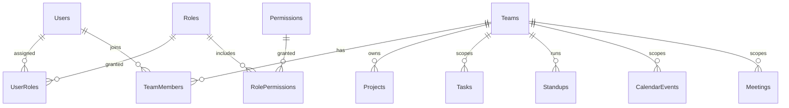
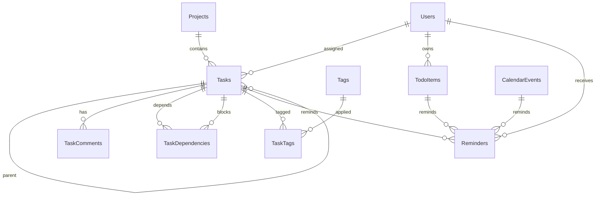
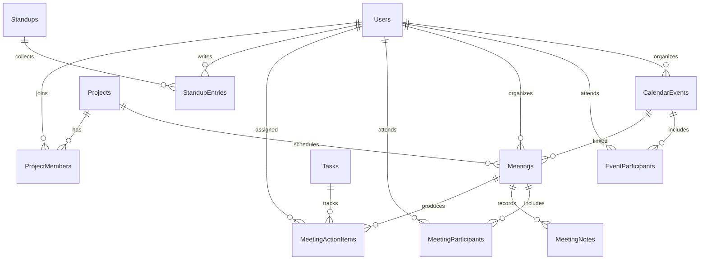
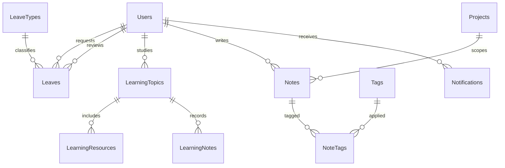

# Worknexa entity relationship diagram

Primary keys are `uniqueidentifier` values. Every table also has `CreatedAt`, `UpdatedAt`, `CreatedBy`, and `UpdatedBy`. `CreatedBy` and `UpdatedBy` reference `Users` and are omitted below so the business relationships stay readable. Soft-deleted tables add `DeletedAt` and `DeletedBy`.

## Identity and organization

## Productivity

## Calendar, meetings, and projects

## Leave, learning, knowledge, and system

`ActivityLogs` and `Attachments` point at a record with `EntityName` and `EntityId` instead of a foreign key to every table.
